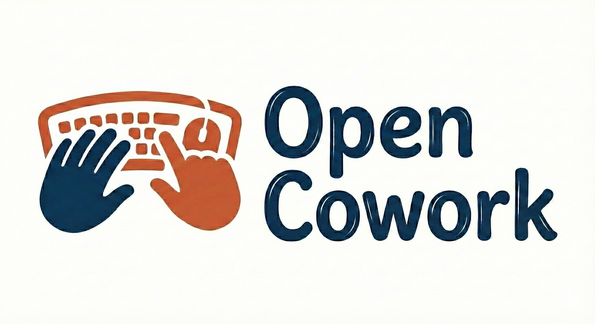

<p align="center">
  
</p>

<h1 align="center">🚀 Open Cowork: Your Personal AI Agent Desktop App</h1>

<p align="center">
  • Open Source Claude Cowork • One-Click Install 
</p>

<p align="center">
  <a href="./README_zh.md">中文文档</a> •
  <a href="#features">Features</a> •
  <a href="#demo">Demo</a> •
  <a href="#installation">Downloads</a> •
  <a href="#quick-start">Quick Start</a> •
  <a href="#skills">Skills Library</a> •
  <a href="#-mcp-subsystem">MCP</a> •
  <a href="#-memory-subsystem">Memory</a> •
  <a href="#sqowe-specific-features">Sqowe Features</a>
</p>

<p align="center">
  
  
  
  <a href="https://discord.gg/pynjtQDf"></a>
  <a href="#community"></a>
</p>

---

Open Cowork is a free, open-source AI agent desktop application for Windows and macOS. It wraps Claude Code, OpenAI, Gemini, DeepSeek, and other AI models into a user-friendly GUI with one-click installation — no coding required. Key capabilities include VM-level sandbox isolation (WSL2 on Windows, Lima on macOS), a built-in Skills system for generating PPTX, DOCX, XLSX, and PDF documents, MCP (Model Context Protocol) integration for connecting to browsers, Notion, and other desktop apps, GUI automation via computer use, and remote control through Feishu (Lark) and Slack. Open Cowork is the open-source implementation of Claude Cowork, designed to make AI-powered desktop automation accessible to everyone.

---

## 📖 Introduction

**Open Cowork** is an open-source implementation of **Claude Cowork**, with one-click installers for **Windows** and **macOS**—no coding required.

It provides a sandboxed workspace where AI can manage files, generate professional outputs (PPTX, DOCX, XLSX, etc.) through our built-in **Skills** system, and **connect to desktop apps via MCP** (browser, Notion, etc.) for better collaboration.

> [!WARNING]
> **Disclaimer**: Open Cowork is an AI collaboration tool. Please exercise caution with its operations, especially when authorizing file modifications or deletions. We support VM-based sandbox isolation, but some operations may still carry risks.

---

<a id="features"></a>

## ✨ Key Features

|               | MCP & Skills | Remote Control | GUI Operation |
| ------------- | ------------ | -------------- | ------------- |
| Claude Cowork | ✓            | ✗              | ✗             |
| OpenClaw      | ✓            | ✓              | ✗             |
| OpenCowork    | ✓            | ✓              | ✓             |

- **One-Click Install, Ready to Use**: Pre-built installers for Windows and macOS, no environment setup needed—just download and start using.
- **Flexible Model Support**: Supports **Claude**, **OpenAI-compatible APIs**, and Chinese models like **GLM**, **MiniMax**, **Kimi**. Use your OpenRouter, Anthropic, or other API keys with flexible configuration. More models coming soon!
- **Remote Control**: Connect to collaboration platforms like **Feishu (Lark)** and other remote services to automate workflows and cross-platform operations.
- **GUI Operation**: Control and interact with various desktop GUI applications on your computer. **Recommended model: Gemini-3-Pro** for optimal GUI understanding and control.
- **Smart File Management**: Read, write, and organize files within your workspace.
- **Skills System**: Built-in workflows for PPTX, DOCX, PDF, XLSX generation and processing. **Supports custom skill creation and deletion.**
- **Task Scheduling**: Anacron-style in-app task scheduling with fuzzy time windows (morning/afternoon/evening/night), autonomous execution mode, missed-task catch-up policies, per-run token/time budgets, and full run history tracking.
- **MCP External Service Support**: Integrate browser, Notion, custom apps and more through **MCP Connectors** to extend AI capabilities. **Per-session toggle** lets you disable unused servers on-the-fly to reclaim context window tokens.
- **Skill Pinning**: Star specific skills to tell the AI "use these for this session" — no more manually typing tool instructions every time.
- **Multimodal Input**: Drag & drop files and images directly into the chat input for seamless multimodal interaction.
- **Real-time Trace**: Watch AI reasoning and tool execution in the Trace Panel.
- **Secure Workspace**: All operations confined to your chosen workspace folder.
- **VM-Level Isolation**: WSL2 (Windows) and Lima (macOS) VM isolation—all commands execute in an isolated VM to protect your host system.
- **UI Enhancements**: Beautiful and flexible UI design, system language switching, comprehensive MCP/Skills/Tools call display.

<a id="demo"></a>

## 🎬 Demo

See Open Cowork in action:

### 1. Folder Organization & Cleanup 📂

https://github.com/user-attachments/assets/dbeb0337-2d19-4b5d-a438-5220f2a87ca7

### 2. Generate PPT from Files 📊

https://github.com/user-attachments/assets/30299ded-0260-468f-b11d-d282bb9c97f2

### 3. Generate XLSX Spreadsheets 📉

https://github.com/user-attachments/assets/f57b9106-4b2c-4747-aecd-a07f78af5dfc

### 4. GUI Operation🖥

https://github.com/user-attachments/assets/75542c76-210f-414d-8182-1da988c148f2

### 5. Remote control with Feishu(Lark) 🤖

https://github.com/user-attachments/assets/05a703de-c0f5-407b-9a43-18b6a172fd74

---

<a id="installation"></a>

## 📦 Installation

### Option 1: Homebrew (macOS, Recommended)

```bash
brew tap OpenCoworkAI/tap
brew install --cask --no-quarantine open-cowork
```

> The `--no-quarantine` flag bypasses macOS Gatekeeper, so you won't see the "Apple cannot verify this app" warning.

### Option 2: Download Installer

Get the latest version from our [Releases Page](https://github.com/OpenCoworkAI/open-cowork/releases).

| Platform                  | File Type |
| ------------------------- | --------- |
| **Windows**               | `.exe`    |
| **macOS** (Apple Silicon) | `.dmg`    |

### Option 3: Build from Source

For developers who want to contribute or modify the codebase:

```bash
git clone https://github.com/OpenCoworkAI/open-cowork.git
cd open-cowork
npm install
npm rebuild better-sqlite3   # rebuild native module for host Node.js (required for tests)
npm run dev
```

> **Why `npm rebuild better-sqlite3`?** The `postinstall` script rebuilds the native
> SQLite module against Electron's ABI (needed for the packaged app). To run tests
> locally with `npm test`, you must rebuild it for your host Node.js. Run this after
> every `npm install` or `npm ci`.

To build the installer locally: `npm run build`

### Security Configuration: 🔒 Sandbox Support

Open Cowork provides **multi-level sandbox protection** to keep your system safe:

| Level        | Platform | Technology | Description                                    |
| ------------ | -------- | ---------- | ---------------------------------------------- |
| **Basic**    | All      | Path Guard | File operations restricted to workspace folder |
| **Enhanced** | Windows  | WSL2       | Commands execute in isolated Linux VM          |
| **Enhanced** | macOS    | Lima       | Commands execute in isolated Linux VM          |

- **Windows (WSL2)**: When WSL2 is detected, all Bash commands are automatically routed to a Linux VM. The workspace is synced bidirectionally.
- **macOS (Lima)**: When [Lima](https://lima-vm.io/) is installed (`brew install lima`), commands run in an Ubuntu VM with `/Users` mounted.
- **Fallback**: If no VM is available, commands run natively with path-based restrictions.

**Setup (Optional, Recommended)**

- **Windows**: WSL2 is auto-detected if installed. [Install WSL2](https://docs.microsoft.com/en-us/windows/wsl/install)

- **macOS**:
  Lima is auto-detected if installed. Install command:

```bash
brew install lima
# Open Cowork will automatically create and manage a 'claude-sandbox' VM
```

---

<a id="quick-start"></a>

## 🚀 Quick Start Guide

### 1. Get an API Key

You need an API key to power the agent. We support **OpenRouter**, **Anthropic**, and various cost-effective **Chinese Models**.

| Provider           | Get Key / Coding Plan                                                      | Base URL (Required)                      | Recommended Model    |
| ------------------ | -------------------------------------------------------------------------- | ---------------------------------------- | -------------------- |
| **OpenRouter**     | [OpenRouter](https://openrouter.ai/)                                       | `https://openrouter.ai/api`              | `claude-4-5-sonnet`  |
| **Anthropic**      | [Anthropic Console](https://console.anthropic.com/)                        | (Default)                                | `claude-4-5-sonnet`  |
| **Zhipu AI (GLM)** | [GLM Coding Plan](https://bigmodel.cn/glm-coding) (⚡️Chinese Deal)         | `https://open.bigmodel.cn/api/anthropic` | `glm-4.7`, `glm-4.6` |
| **MiniMax**        | [MiniMax Coding Plan](https://platform.minimaxi.com/subscribe/coding-plan) | `https://api.minimaxi.com/anthropic`     | `minimax-m2`         |
| **Kimi**           | [Kimi Coding Plan](https://www.kimi.com/membership/pricing)                | `https://api.kimi.com/coding/`           | `kimi-k2`            |

### 2. Configure

1. Open the app and click the ⚙️ **Settings** icon in the bottom left.
2. Paste your **API Key**.
3. **Crucial**: Set the **Base URL** according to the table above (especially for Zhipu/MiniMax, etc.).
4. Enter the **Model** name you want to use.

### 3. Start Coworking

1. **Select a Workspace**: Choose a folder where Claude is allowed to work.
2. **Enter a Prompt**:
   > "Read the financial_report.csv in this folder and create a PowerPoint summary with 5 slides."

### 📝 Important Notes

1.  **macOS Installation**: If you downloaded the DMG directly (not via Homebrew) and see a security warning, go to **System Settings > Privacy & Security** and click **Open Anyway**. Or install via Homebrew to avoid this entirely:
    ```bash
    brew tap OpenCoworkAI/tap && brew install --cask --no-quarantine open-cowork
    ```
2.  **Network Access**: For tools like `WebSearch`, you may need to enable "Virtual Network Interface" (TUN Mode) in your proxy settings to ensure connectivity.
3.  **Notion Connector**: Besides setting the integration token, you also need to add connections in a root page. See https://www.notion.com/help/add-and-manage-connections-with-the-api for more details.

---

<a id="skills"></a>

## 🧰 Skills Library

Open Cowork ships with built-in skills under `.claude/skills/`, and supports user-added or custom skills, including:

- `pptx` for PowerPoint generation
- `docx` for Word document processing
- `pdf` for PDF handling and forms
- `xlsx` for Excel spreadsheet support
- `skill-creator` for creating custom skills

### Built-in Skill Auto-Update

Built-in skills are automatically kept in sync with app updates using content-hash versioning. When you install a new version of Open Cowork:

1. Each bundled skill's `SKILL.md` is hashed (SHA-256)
2. The hash is compared against the runtime copy's `.builtin-hash` stamp
3. If the hash differs (or no stamp exists), the runtime copy is replaced with the fresh bundled version
4. Skills that haven't changed are left untouched — no unnecessary I/O

This means app updates reliably deliver skill improvements without requiring manual cache clearing or reinstallation.

### Protecting Customized Skills

If you've modified a built-in skill and want to prevent it from being overwritten on app updates, create a `.user-modified` marker file inside the skill's runtime directory:

```bash
# macOS
touch ~/Library/Application\ Support/open-cowork/.claude/skills/docx/.user-modified

# Windows
type nul > "%APPDATA%\open-cowork\.claude\skills\docx\.user-modified"
```

When the marker is present, the auto-update will skip that skill and log a warning instead. To resume receiving updates, simply delete the `.user-modified` file.

---

<a id="sqowe-specific-features"></a>

## 🔧 Sqowe-Specific Features

This is the **Sqowe** variant of Open Cowork. It tracks upstream functionality and adds the following on top:

- **Bash Command Restrictions**: A configurable allow/deny engine that gates every bash command the agent runs. Trusted patterns run automatically, denied patterns always prompt, and everything else requires explicit approval. See [BASH_COMMAND_RESTRICTIONS.md](BASH_COMMAND_RESTRICTIONS.md) for configuration details, pattern syntax, and edge cases.
- **Configurable Permission Timeout**: Permission dialogs auto-deny after a configurable timeout (default: 5 minutes). Set to 0 for infinite wait. Configurable in Settings → Bash Commands.
- **Customizable System Prompt**: The AI's system prompt is fully editable via Settings → System Prompt. Each section (identity, behavioral rules, citations, tool routing) is a separate file that can be independently edited, disabled, or reset. Workspace-level overrides in `.cowork/prompts/` replace global sections per-project. Template variables (`{{cwd}}`, `{{project_name}}`, `{{date}}`, `{{model}}`) are resolved at runtime.
- **Per-Session MCP Server Toggle**: Disable/enable MCP servers on-the-fly from the Context Panel without restarting the session. Reduces context window token usage by shedding unused tool schemas mid-conversation. Supports workspace-level profiles via `.cowork/mcp-servers.json` (committable to git) for team-wide defaults.
- **Skill Pinning**: Star/pin specific skills (semantic-index, firecrawl, docx, etc.) to explicitly tell the AI to prioritize them for the current session. All skills remain available — pinning adds emphasis, not restriction. Select skills on the Welcome screen before starting a chat, or pin/unpin mid-conversation from the Context Panel. Enforces a max of 10 pinned skills per session with full validation.

---

## 🔌 MCP Subsystem

Open Cowork integrates [MCP (Model Context Protocol)](https://modelcontextprotocol.io/) to connect the AI agent with external tools and services — browsers, databases, Notion, custom APIs, and more. MCP servers run on the host machine and their tools are bridged into the agent's tool dispatch layer as first-class capabilities.

### Transport Types

| Transport           | Use Case                                    | Example                         |
| ------------------- | ------------------------------------------- | ------------------------------- |
| **stdio**           | Local CLI tools, spawned as child processes | Firecrawl, Context7, filesystem |
| **SSE**             | Remote servers with HTTP streaming          | Self-hosted services            |
| **Streamable HTTP** | Modern remote servers (MCP 2025+)           | Cloud-hosted MCP endpoints      |

### Server Descriptions (Auto-Generated LLM Routing)

When multiple MCP servers are connected, the LLM sees a flat list of tools named `mcp__<ServerName>__<toolName>`. Without additional context, it can struggle to pick the right server for a task. Open Cowork solves this with **server-level descriptions** — concise summaries of what each server does, injected into the system prompt as a routing map.

**How it works:**

1. **Auto-generation on first connect** — When a server's tools are discovered for the first time, Open Cowork generates a description using the user's configured LLM (one-shot call, ~150–300 input tokens, negligible cost). The prompt asks for a single sentence (max 25 words) describing the server's domain and capabilities.

2. **Heuristic fallback** — If no LLM is available (no API key configured, network error), a template-based summary is generated from tool names and descriptions. Examples:
   - Firecrawl → `"Web scraping, crawling, search, and structured data extraction from websites."`
   - Context7 → `"Library and framework documentation lookup with version-specific code examples."`
   - A generic server → `"My Server (8 tools)"`

3. **MCP Server Directory in system prompt** — All descriptions are assembled into a `<mcp_server_directory>` block injected into the agent's system prompt:

   ```
   Available MCP servers and their capabilities:
   - Firecrawl: Web scraping, crawling, search, and structured data extraction from websites.
   - Context7: Library and framework documentation lookup with version-specific code examples.
   - Software_Development: File system operations, code search, and project workspace management.

   Use the appropriate server's tools based on the task domain.
   ```

   Token cost: ~15–25 tokens per server (negligible compared to tool schemas themselves).

4. **Change detection** — A SHA-256 hash of the tool list (names + descriptions) is stored alongside the description. When tools change (server update, new tools added), the system detects the mismatch and notifies the user — it never silently overwrites.

5. **User control** — Descriptions can be manually edited at any time. The system tracks whether a description is `auto` (generated) or `manual` (user-written). Manual descriptions suppress stale-tool notifications, since the user wrote them intentionally.

**UI actions:**

- **Edit** — Make the description field editable, sets source to `manual` on save
- **Regenerate** — Re-run LLM one-shot, replaces description, source stays `auto`
- **Dismiss** — Acknowledge tool changes without regenerating (keeps current description)

### Per-Session & Per-Workspace Server Toggle

MCP tool schemas consume significant context window tokens. To optimize usage, servers can be selectively disabled at three levels (highest priority wins):

1. **Session override** (ephemeral) — Toggle in the Context Panel mid-conversation. Stored in-memory, cleared on session delete.
2. **Workspace profile** — `.cowork/mcp-servers.json` with `disabled`/`enabled` arrays. Committable to git for team-wide defaults.
3. **Global config** — Per-server `enabled` boolean in Settings UI.

**Save to Workspace button** — The MCP Connectors section header includes a 💾 save icon that appears when you have session-disabled servers and a working directory set. Clicking it writes the current session toggle state to `.cowork/mcp-servers.json`, making your MCP setup persistent and shareable with your team via git.

**Workspace profile example** (`.cowork/mcp-servers.json`):

```json
{
  "disabled": ["firecrawl", "gui-operate"],
  "enabled": ["context7"]
}
```

- Servers in `disabled` are excluded from the session (overrides global enabled state)
- Servers in `enabled` are explicitly included (overrides the `disabled` list)
- Servers not mentioned in either array pass through unchanged — their global config `enabled` state is preserved as-is (globally enabled → stays enabled, globally disabled → stays disabled)
- Accepts both server IDs (`mcp-1716547200000`) and display names (`"EU Law"`) — the resolver matches against both

### Configuration

MCP servers are configured in the app's Settings panel. Each server entry includes:

- **Name** — Display name (used in tool prefixes)
- **Type** — `stdio`, `sse`, or `streamable-http`
- **Command/URL** — How to connect (command + args for stdio, URL for HTTP-based)
- **Environment variables** — Passed to stdio processes
- **Description** — Auto-generated or manually written routing hint
- **Enabled** — Global on/off toggle
- **Tool timeout** — Per-server timeout override (0 = use global default)

Key files: `src/main/mcp/mcp-manager.ts`, `src/main/mcp/mcp-config-store.ts`, `src/main/mcp/mcp-description-generator.ts`.

---

## 🧠 Memory Subsystem

Open Cowork includes an automatic memory system that persists knowledge across sessions. The agent accumulates learnings from past conversations and uses them to provide better, more contextual responses in future sessions.

### How It Works

Memory is **fully automatic** — the LLM does not decide whether to use memory. Instead, relevant memory is searched and injected into the prompt **before** the LLM sees the user's message:

```
User sends message
       │
       ▼
Memory Extension (beforeSessionRun)
       │
       ├─ 1. Embed the user's prompt (vector representation)
       ├─ 2. Search memory stores (vector + lexical hybrid)
       ├─ 3. Navigator LLM decides if expansion is needed
       ├─ 4. Build <memory_context> XML block
       │
       ▼
Combined prompt = memory_context + user_message
       │
       ▼
LLM receives the combined prompt (memory is already there)
       │
       ▼
LLM responds
       │
       ▼
Memory Extension (afterSessionRun)
       │
       ├─ Extract reusable chunks from the conversation
       ├─ Update core memory if stable preferences were revealed
       │
       ▼
Done — knowledge persisted for future sessions
```

### Two Levels of Memory

**Core Memory** — stable user profile (always included in full)

Stores durable information that persists across all sessions and workspaces:

- Identity: role, background, recurring context
- Preferences: communication style, workflow, tools
- Skills: competencies, toolchains, strengths
- Interests: recurring domains and deep topics

Core memory is small (typically <20 entries) and updated conservatively. Only information with strong evidence of being stable across time gets stored here.

**Experience Memory** — past session knowledge (searched per-query)

Stores reusable work units extracted from past conversations:

- Goals the user was trying to accomplish
- Decisions and their rationale
- Implementation choices and important steps
- Constraints, caveats, failure modes, tradeoffs
- Concrete outcomes and unresolved follow-ups

Each session produces 1–8 chunks, each with an embedding vector for semantic search.

### Retrieval Scoring

Experience memory is ranked using a hybrid scoring algorithm:

| Signal                         | Description                                                   |
| ------------------------------ | ------------------------------------------------------------- |
| Vector similarity              | Cosine similarity between query embedding and chunk embedding |
| Lexical score                  | Keyword overlap between query and chunk text                  |
| Workspace boost (+0.3)         | Chunks from the same workspace rank higher                    |
| Recency boost (+0.02 to +0.08) | Newer chunks get a small boost (decays over 45 days)          |

Top 10 chunks and top 5 sessions are retrieved. A Navigator LLM then decides whether to expand any results (get full details or raw session transcripts) based on relevance.

### Search Scope

- **Core memory** is always global — included regardless of workspace
- **Experience memory** prioritizes the current workspace (+0.3 boost) but does not filter out other workspaces. Knowledge from other projects still surfaces if semantically relevant — it just ranks lower.

### Progressive Retrieval

The system uses a multi-step retrieval process:

1. **Broad summaries** — initial ranked list of chunk/session summaries
2. **Navigator decision** — a lightweight LLM call decides if more detail is needed
3. **Expansion** — specific chunks or sessions are expanded (details, raw text, or full transcript)
4. **Repeat** — up to `maxNavSteps` iterations until the navigator deems context sufficient

This avoids injecting too much irrelevant context while ensuring important details are available when needed.

### Storage

Memory data lives at `~/Library/Application Support/open-cowork/memory/` (macOS):

| File                     | Contents                                             |
| ------------------------ | ---------------------------------------------------- |
| `core_memory.json`       | Stable user profile (interests, preferences, skills) |
| `experience_memory.json` | Session summaries, chunks, and embeddings            |
| `session_state.json`     | Tracks which sessions have been ingested             |

### Configuration

Memory is enabled by default. Toggle it in **Settings → Memory** or via the Memory panel in the sidebar. Disabling memory stops future ingestion and auto-recall but keeps existing records intact.

When in-app memory is enabled, the legacy `cowork-memory` skill (manual Python scripts) is automatically disabled to avoid redundancy. If you disable in-app memory, the skill is re-enabled as a fallback.

---

## 🏗️ Architecture

```
open-cowork/
├── src/
│   ├── main/                    # Electron Main Process (Node.js)
│   │   ├── index.ts             # Main entry point
│   │   ├── claude/              # Agent SDK & Runner
│   │   │   └── agent-runner.ts  # AI agent execution logic
│   │   ├── config/              # Configuration management
│   │   │   └── config-store.ts  # Persistent settings storage
│   │   ├── db/                  # Database layer
│   │   │   └── database.ts      # SQLite/data persistence
│   │   ├── ipc/                 # IPC handlers
│   │   ├── memory/              # Memory management
│   │   │   └── memory-manager.ts
│   │   ├── sandbox/             # Security & Path Resolution
│   │   │   └── path-resolver.ts # Sandboxed file access
│   │   ├── session/             # Session management
│   │   │   └── session-manager.ts
│   │   ├── schedule/            # Task scheduling (v2)
│   │   │   └── scheduled-task-manager.ts
│   │   ├── skills/              # Skill Loader & Manager
│   │   │   └── skills-manager.ts
│   │   └── tools/               # Tool execution
│   │       └── tool-executor.ts # Tool call handling
│   ├── preload/                 # Electron preload scripts
│   │   └── index.ts             # Context bridge setup
│   └── renderer/                # Frontend UI (React + Tailwind)
│       ├── App.tsx              # Root component
│       ├── main.tsx             # React entry point
│       ├── components/          # UI Components
│       │   ├── ChatView.tsx     # Main chat interface
│       │   ├── ConfigModal.tsx  # Settings dialog
│       │   ├── ContextPanel.tsx # File context display
│       │   ├── MessageCard.tsx  # Chat message component
│       │   ├── PermissionDialog.tsx
│       │   ├── Sidebar.tsx      # Navigation sidebar
│       │   ├── Titlebar.tsx     # Custom window titlebar
│       │   ├── TracePanel.tsx   # AI reasoning trace
│       │   └── WelcomeView.tsx  # Onboarding screen
│       ├── hooks/               # Custom React hooks
│       │   └── useIPC.ts        # IPC communication hook
│       ├── store/               # State management
│       │   └── index.ts
│       ├── styles/              # CSS styles
│       │   └── globals.css
│       ├── types/               # TypeScript types
│       │   └── index.ts
│       └── utils/               # Utility functions
├── .claude/
│   └── skills/                  # Default Skill Definitions
│       ├── pptx/                # PowerPoint generation
│       ├── docx/                # Word document processing
│       ├── pdf/                 # PDF handling & forms
│       ├── xlsx/                # Excel spreadsheet support
│       └── skill-creator/       # Skill development toolkit
├── resources/                   # Static Assets (icons, images)
├── electron-builder.yml         # Build configuration
├── vite.config.ts               # Vite bundler config
└── package.json                 # Dependencies & scripts
```

---

## 🗺️ Roadmap

See our full **[ROADMAP.md](ROADMAP.md)** for detailed plans.

**Completed:** Core installers · Filesystem sandboxing · VM isolation (WSL2/Lima) · Skills (PPTX/DOCX/PDF/XLSX) · MCP connectors · Multi-model support · Rich input · i18n · Task scheduling (v2)

**Coming next:** Memory optimization · Linux support · Plugin system · Computer use · Stable release

---

## ❓ FAQ

**What is Open Cowork?**
Open Cowork is a free, open-source desktop application that provides a local AI agent workspace. It wraps AI models (Claude, GPT, Gemini, DeepSeek, etc.) into a GUI with one-click installers for Windows and macOS — no terminal or coding knowledge required.

**How is Open Cowork different from Claude Cowork?**
Open Cowork is the open-source implementation of Claude Cowork. It adds multi-model support (not just Claude), GUI automation via computer use, remote control through Feishu/Slack, and VM-level sandbox isolation. See the [feature comparison table](#features) for details.

**What AI models does Open Cowork support?**
Claude (via Anthropic or OpenRouter), OpenAI-compatible APIs, and Chinese models including GLM (Zhipu AI), MiniMax, and Kimi. Any provider offering an OpenAI-compatible API endpoint can be configured.

**Is Open Cowork free?**
Yes. Open Cowork itself is completely free and open-source under the MIT license. You only need to pay for the AI model API usage from your chosen provider.

**Does Open Cowork work on Linux?**
Currently, Open Cowork provides pre-built installers for Windows and macOS only. Linux users can build from source — see the [Build from Source](#installation) section.

**How does sandbox isolation work?**
Open Cowork offers multi-level protection: basic path-based restrictions on all platforms, and enhanced VM-level isolation using WSL2 (Windows) or Lima (macOS). When a VM is available, all commands execute inside an isolated Linux environment, protecting your host system.

**What are Skills and how do I create custom ones?**
Skills are built-in workflows for specific tasks like generating PPTX, DOCX, PDF, or XLSX files. Open Cowork ships with default skills under `.claude/skills/` and includes a `skill-creator` tool to help you build your own custom skills.

**What is MCP and how does it work?**
MCP (Model Context Protocol) lets AI connect to external tools and services. Open Cowork supports MCP connectors for browsers, Notion, and other desktop apps — extending the AI's capabilities beyond just file management and code.

**How do I set up remote control via Feishu or Slack?**
Open Cowork supports remote control through Feishu (Lark) and Slack integration, allowing you to send commands and receive results from collaboration platforms. Check the app settings for remote control configuration.

**Is my data safe? Does Open Cowork send data to external servers?**
Open Cowork runs locally on your machine. Your files stay in your workspace. The only external communication is with the AI model API you configure (e.g., Anthropic, OpenRouter). No data is sent to Open Cowork servers.

---

## 🛠️ Contributing

We welcome contributions! Whether it's a new Skill, a UI fix, or a security improvement:

1. Fork the repo.
2. Create a branch (`git checkout -b feature/NewSkill`).
3. Submit a PR.

---

## 💬 Community

Join our community for support and discussion:

- **Discord**: [Join our Discord server](https://discord.gg/pynjtQDf) — for real-time chat, support, and development discussion.
- **WeChat**: Scan the QR code below to join our WeChat group (Chinese community).

<p align="center">
  
</p>

---

## 📄 License

MIT © Open Cowork Team

---

<p align="center">
  Made with ❤️ by the Open Cowork Team with the help of opus4.5
</p>
