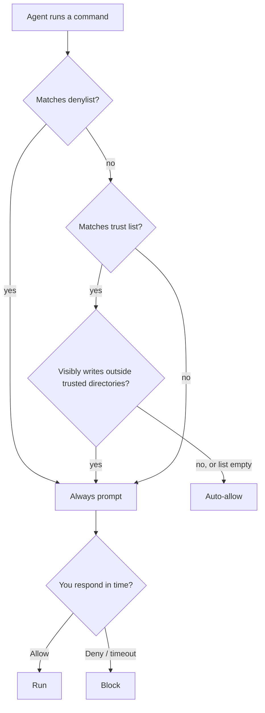

<!-- sources: src/renderer/components/settings/SettingsBashCommands.tsx, src/shared/bash-restrictions/, src/shared/path-permissions/, BASH_COMMAND_RESTRICTIONS.md, src/main/config/config-store.ts (AppConfig) -->

# Bash command restrictions

## What it is / when to use it

Every shell command the agent wants to run passes through a **trust/deny engine** before it
executes. You maintain a **trust list** of safe patterns (which run automatically) and a
**denylist** of dangerous ones (which always prompt, even if something trusted would match).
Everything else prompts for your approval. This keeps the agent fast on routine work without
letting it run something destructive unseen.

A third list, **trusted directories**, says where the agent may write without asking — for
shell commands and for the file-writing tools alike.

Reach for this when: you want common commands to stop nagging you for approval, you want
to guarantee certain commands always require a yes, or you want the agent to work freely
inside the project but ask before it writes anywhere else.

## How to use it

1. Open **Settings → Bash Commands**.
2. **Trusted commands** — add prefix patterns. A trailing `*` is a wildcard, e.g.
   `ls *`, `git status*`, `npm run *`. Matching commands run without prompting.
3. **Denied commands** — add substrings that always force a prompt, e.g. `rm`, `sudo`,
   `git push`, `--force`. A deny hit wins even over a trust match.
4. **Trusted directories** — add the directories the agent may write to without being
   asked, one per line, e.g. `./` (the session's workspace) and `/tmp`. A write inside them
   runs; a write anywhere else asks. This covers the `write` and `edit` tools and the places a
   shell command visibly writes (`>`, `>>`, `tee`). Leave it empty to turn the check off.
5. **Permission timeout** — set how long an approval dialog waits before auto-denying
   (default **300s**; set to **0** for no timeout / wait forever).

The approval dialog says why it appeared — a denied word, a command that is not on the trust
list, or a write outside the trusted directories.

> **Not a sandbox.** Trusted directories check the writes that can be read from the command
> itself. What a program writes on its own (`python3 script.py`) cannot be seen. Your home
> directory and the file-system root are not accepted as entries.

<!-- derived:diagram source=src/shared/bash-restrictions/engine.ts -->

<!-- /derived -->

> ⚠️ TODO (human): capture this → docs/wiki/assets/bash-restrictions-settings.png

## Commands & settings

| Action                | How to run                                         |
| --------------------- | -------------------------------------------------- |
| Add trusted pattern   | Settings → Bash Commands → **Trusted commands**    |
| Add denied substring  | Settings → Bash Commands → **Denied commands**     |
| Add trusted directory | Settings → Bash Commands → **Trusted directories** |
| Set approval timeout  | Settings → Bash Commands → **Permission timeout**  |

| Setting                    | Default                 | What it does                                                 |
| -------------------------- | ----------------------- | ------------------------------------------------------------ |
| `bashTrustedCommands`      | _(small safe set)_      | Prefix patterns (with `*` wildcard) auto-approved.           |
| `bashDenylist`             | _(small dangerous set)_ | Substrings that always force a prompt.                       |
| `trustedDirectories`       | _(empty — check off)_   | Directories the agent may write to without being asked.      |
| `permissionTimeoutSeconds` | `300`                   | Seconds before an approval auto-denies (`0` = wait forever). |

The same engine powers the standalone `pi` CLI restriction add-on, so behavior is consistent.
Full pattern syntax and edge cases are in `BASH_COMMAND_RESTRICTIONS.md`.

**Related guide:** approvals in general — see [Approvals & safety](permissions-and-safety.md).

---

[← All docs](../index.md)
