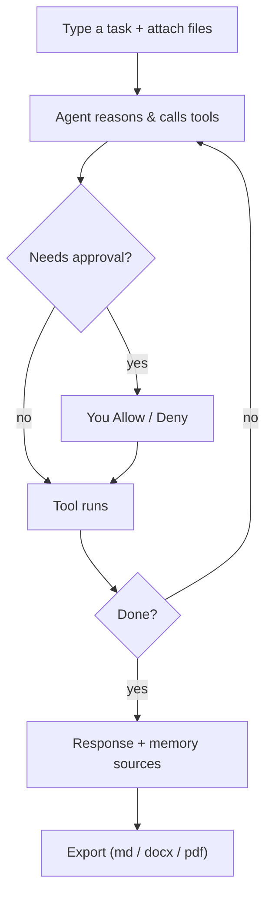

<!-- sources: src/renderer/components/ChatView.tsx, src/renderer/components/Sidebar.tsx, src/renderer/components/message/*, src/main/chat/export-router.ts, README -->

# Chat & sessions

## What it is / when to use it

The chat is where you actually get work done: you describe a task, the agent reasons and uses
tools, and you watch it happen. Each conversation is a **session** that persists across
restarts, so you can pick up on Monday where you left off on Friday. You can stop a run
mid-way, attach files and images, follow the agent's thinking, and export the whole thing.

## How to use it

1. From the **Sidebar**, click **New session** (or start one from the Welcome screen).
2. Type your message and press **Enter** (use `Shift`+`Enter` for a newline).
3. **Attach files or images** by dragging them into the input box, or pasting.
4. While the agent works, watch the message trace: it shows the agent's **thinking**, each
   **tool call** with its input and output, and any **questions** it asks you.
5. Need to interrupt? Click **Stop** — the run halts at the next safe point.
6. When a sensitive action needs approval, a dialog appears — see
   [Approvals & safety](permissions-and-safety.md).

> ⚠️ TODO (human): capture this → docs/wiki/assets/chat-and-sessions-running.png

### Sessions sidebar

Sessions are listed in the sidebar, grouped by **date** (Today / Yesterday / Previous week /
Older) or by **workspace**. Hover a session to rename, delete, or open it; use the search
icon (or `Ctrl`/`Cmd`+`K`) to find past chats — see [Search conversations](search.md).

### Export a chat

1. Open the message menu and choose **Export full chat** (or **Export selected…** to pick
   specific messages).
2. In the options dialog, choose what to include: **tool calls** (collapsed), **thinking**,
   **timestamps**, **token usage**, and how to handle **images** (placeholder or skip).
3. Pick a format — **Markdown** (`.md`), **Word** (`.docx`), or **PDF** (`.pdf`) — and save.

<!-- derived:diagram source=src/renderer/components/ChatView.tsx -->

<!-- /derived -->

## Commands & settings

| Action               | How to run                                                 |
| -------------------- | ---------------------------------------------------------- |
| New session          | Sidebar → **New session**                                  |
| Stop a run           | **Stop** button in the composer (while running)            |
| Export chat          | Message menu → **Export full chat** / **Export selected…** |
| Select messages      | `Ctrl`/`Cmd`+`A` in the composer toggles selection mode    |
| Search conversations | `Ctrl`/`Cmd`+`K` (or Sidebar search icon)                  |

| Setting                     | Default | What it does                                    |
| --------------------------- | ------- | ----------------------------------------------- |
| `thinkingLevel` (per model) | varies  | Whether/how much the agent shows its reasoning. |

**Related guides:** the model in use is set in [Models & API](models-and-api.md); what the
agent "remembers" appears as a sources badge — see [Memory](memory.md).

---

[← All docs](../index.md)
