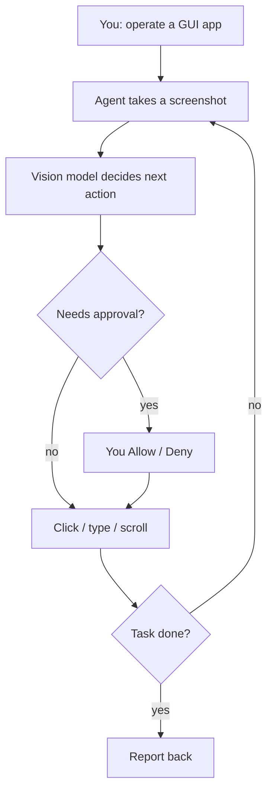

<!-- sources: src/main/mcp/gui-operate-server.ts, src/main/mcp/mcp-config-store.ts, README, ARCHITECTURE.md §4.3 -->

# GUI operation

## What it is / when to use it

Sqowe Pilot includes a built-in MCP server called **gui-operate** that lets the agent
**see your screen and control desktop apps** — click, type, scroll, and read what's on
screen using a vision-capable model. It's how the agent can "check my email in Chrome",
"fill out this form", or drive an app that has no API.

Reach for this when: the task is in a GUI application (a browser, a desktop app) rather than
in files.

## How to use it

1. The **gui-operate** server is bundled and appears as a connector. Make sure it's enabled
   under **Settings → Connectors** (it's on by default).
2. Use a **vision-capable model** — **Gemini-3-Pro** is recommended for the best screen
   understanding. Set it in [Models & API](models-and-api.md).
3. Ask in plain language, e.g.:

   > Open Chrome, go to Gmail, and summarize the new emails from the past three days.

4. Watch the agent take screenshots, decide actions, and execute them; sensitive actions
   still go through the [approval dialog](permissions-and-safety.md).

<!-- derived:diagram source=src/main/mcp/gui-operate-server.ts -->

<!-- /derived -->

> ⚠️ TODO (human): capture this → docs/wiki/assets/gui-operation-running.png

## Commands & settings

| Action                       | How to run                                     |
| ---------------------------- | ---------------------------------------------- |
| Enable / disable gui-operate | Settings → Connectors → **gui-operate** toggle |
| Use it                       | Just ask the agent to operate a desktop app    |

It behaves like any other [MCP connector](mcp-connectors.md) for tool permissions and
per-session toggles.

---

[← All docs](../index.md)
