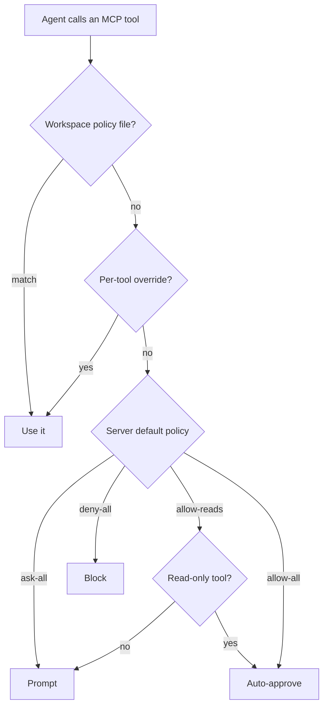

<!-- sources: src/renderer/components/settings/SettingsConnectors.tsx, src/renderer/components/settings/McpToolPermissions.tsx, src/renderer/components/ContextPanel.tsx, src/main/mcp/mcp-manager.ts, src/main/mcp/mcp-tool-permissions.ts, src/main/mcp/mcp-description-generator.ts, src/main/mcp/mcp-workspace-profile.ts, README, ARCHITECTURE.md §4.3, src/main/claude/session-mcp-tools.ts -->

# MCP connectors

## What it is / when to use it

**MCP** (Model Context Protocol) is how the agent reaches outside its folder — to a browser,
Notion, a database, or your own service. You add an **MCP server** (a connector) and its
tools become first-class capabilities the agent can call, just like reading a file. Sqowe
Pilot supports three transports and includes quick-add presets for popular servers.

Reach for this when: you want the agent to drive Chrome, read/write Notion, query an API, or
use any tool that ships as an MCP server.

## How to use it

1. Open **Settings → Connectors**.
2. **Quick Add Presets** to add a popular server in one click, or **Add Custom Connector**
   for your own.
3. For a custom connector, choose a **Type**:
   - **STDIO (Local)** — a local command spawned as a child process (e.g. `npx ...`).
   - **SSE (Remote)** — a remote server with HTTP streaming.
   - **HTTP (Streamable)** — a modern remote server (MCP 2025+).
4. Fill in the command + arguments (STDIO) or URL (HTTP), any environment variables or custom
   headers, and save.
5. Toggle a connector on/off globally with its **Enable** switch.

### Per-session toggle & workspace profiles

MCP tool schemas are large, so you can shed the ones you're not using:

- **In a session** — open the **Context Panel → MCP Connectors** and toggle a server
  **Enable/Disable for this session** (ephemeral, cleared when the session ends). It
  applies from the agent's next step, also in the middle of a conversation: a server
  turned off is no longer offered to the agent, and one turned on is brought in.
- **Save to workspace** — click **Save current setup to workspace** (💾) to write
  `.cowork/mcp-servers.json`, so the same on/off setup loads for everyone who opens the
  project.

### Tool permissions (less approval fatigue)

Each server has a default policy so you're not prompted for every call:

| Policy        | Behavior                                               |
| ------------- | ------------------------------------------------------ |
| `ask-all`     | Every tool prompts (default)                           |
| `allow-reads` | Read-only tools auto-approve; write tools still prompt |
| `allow-all`   | All tools auto-approve                                 |
| `deny-all`    | All tools blocked                                      |

Add **per-tool overrides** for exceptions (e.g. `allow-reads`, but always ask for one risky
tool). Share policies across a team via `.cowork/mcp-permissions.json`.

<!-- derived:diagram source=src/main/mcp/mcp-tool-permissions.ts -->

<!-- /derived -->

### Auto-generated server descriptions

When a server's tools are first discovered, Sqowe Pilot writes a one-sentence **description**
of what the server does (via a single cheap model call; a heuristic fallback if no key is
set). These descriptions form a routing map in the prompt so the agent picks the right server.
You can **Edit** a description (it becomes "manual") or **Regenerate** it; if the server's
tools change, you're notified rather than silently overwritten.

### Progressive trust

The system counts how many times you manually approve the same tool. After 5 approvals, it
suggests promoting that tool to permanent auto-allow.

> ⚠️ TODO (human): capture this → docs/wiki/assets/mcp-connectors-settings.png

## Commands & settings

| Action                  | How to run                                                               |
| ----------------------- | ------------------------------------------------------------------------ |
| Add connector           | Settings → Connectors → **Quick Add Presets** / **Add Custom Connector** |
| Toggle per session      | Context Panel → MCP Connectors → **Enable/Disable for this session**     |
| Save setup to workspace | Context Panel → **Save current setup to workspace** (💾)                 |
| Edit description        | Connector → description field → **Edit**                                 |

| Setting                 | Default        | What it does                                                           |
| ----------------------- | -------------- | ---------------------------------------------------------------------- |
| `mcpToolTimeoutSeconds` | global default | How long to wait for an MCP tool before timing out (0 = wait forever). |

**Related guides:** the built-in **gui-operate** server is documented under
[GUI operation](gui-operation.md). MCP servers always run on your host, never inside the
sandbox.

---

[← All docs](../index.md)
