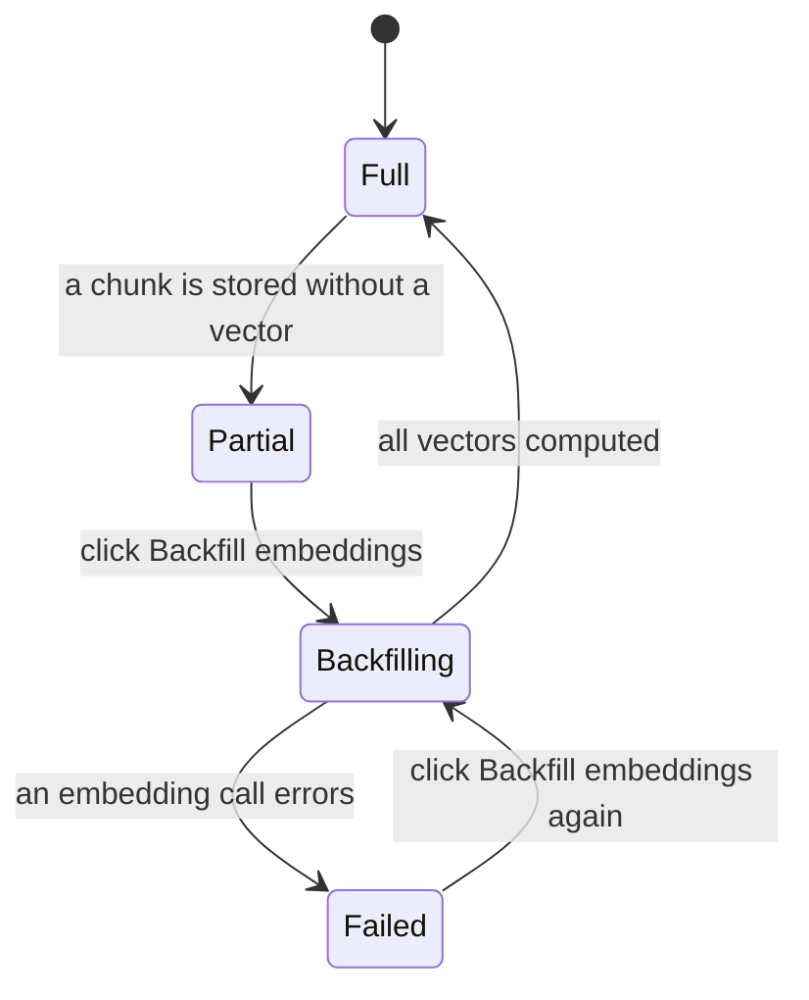
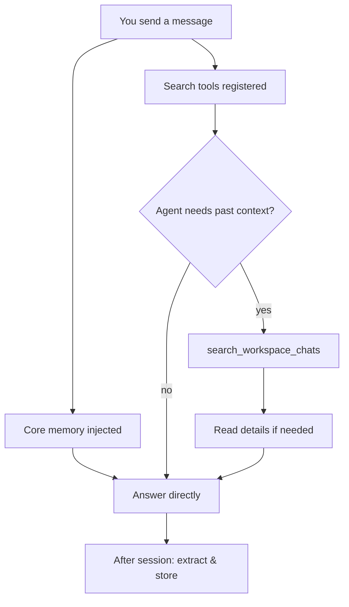

<!-- sources: src/renderer/components/settings/SettingsMemory.tsx, src/renderer/components/MemoryLensSection.tsx, src/renderer/components/message/MemorySourcesBadge.tsx, src/main/memory/memory-extension.ts, src/main/memory/memory-chat-search-tool.ts, README, ARCHITECTURE.md §4.6, docs/design/memory-system-architecture.md, docs/design/archive/memory-storage-sqlite-migration.md, docs/design/archive/embedding-provider-gate-and-coverage.md, docs/design/archive/local-embeddings-default.md -->

# Memory

## What it is / when to use it

Memory lets the agent accumulate knowledge across sessions and use it later, so it gets more
useful the more you use it. It works in two layers:

- **Core memory** (passive) — stable facts about you (role, preferences, skills, interests),
  always present in the prompt. Small, conservative, workspace-filtered.
- **Experience memory** (active) — reusable chunks extracted from past conversations. **Not**
  pre-injected; instead the agent gets tools to search them on demand when it actually needs
  context from a prior chat.

Experience memory is stored in a local **SQLite database** (`memory.db`) under your memory
storage folder — it is portable, so you can back it up or export it (see [Memory storage](#memory-storage-settings--memory--memory-storage)).
Core memory and session bookkeeping stay as small JSON files alongside it.

By default, embeddings run **fully offline and in-process** (EmbeddingGemma via ONNX) — no
Python, no API key, nothing leaves your machine.

Reach for this when: you want the agent to remember your preferences, or recall a decision
from a previous conversation in the same project.

## How to use it

1. Memory is **on by default**. Toggle it under **Settings → Memory**, or from the **Memory**
   panel in the sidebar.
2. **Embeddings** — by default `provider: local` (offline ONNX, model downloads once on first
   use). Switch to a remote embedding provider in **Settings → Memory** if you prefer. The
   embedding model is resolved independently of your **chat** model, so a chat provider with no
   embeddings API never silently blocks recall.
3. **Memory LLM** — optionally configure a separate model for memory extraction/recall, or
   inherit from your active model.
4. When the agent retrieves past context, a badge above its reply tells you:
   - `🧠 Memory contributed to this response` (core memory only), or
   - `🧠 Referenced N past conversation(s) from this workspace` — click to see which sessions
     were used.

### Embedding coverage

When embeddings are enabled, **Settings → Memory** shows an **Embedding coverage** card:
_{{embedded}} of {{total}} chunks embedded ({{percent}}%)_. It has three states:

- **Green** — every stored chunk carries a vector (full semantic recall).
- **Amber** — some chunks have no vector, so they are found by keyword only, not by meaning.
- **Red** — an embedding call failed; the card names the error and when it happened.

When chunks are missing vectors, the card offers a **Backfill embeddings** action. This
computes the missing vectors from text that is already stored — it runs **no** LLM extraction
and deletes nothing — and reports live progress (_Embedding… {{processed}} of {{total}}
records_). Use it after a provider or model change, or if ingestion ever stored chunks without
vectors.

<!-- derived:diagram source=src/renderer/components/settings/SettingsMemory.tsx#embeddingCoverageCard,src/renderer/components/settings/SettingsMemory.tsx#handleBackfillEmbeddings -->

<!-- /derived -->

If you switch the embedding **model**, existing vectors were built in a different space and no
longer compare cleanly. Search then falls back to keyword-only, and a prompt offers to recompute
them (via the same backfill, not a full rebuild). Changing the embedding **format** (the local
model's prefixes) is surfaced the same way.

### The Memory panel

Open the **Memory** panel (sidebar) to inspect what's stored: your **profile** (identity,
interests, preferences, skills), per-workspace session/chunk counts, and the **last
retrieval** (entries matched, chunks retrieved, tokens injected). You can edit or delete any
core-memory entry directly.

<!-- derived:diagram source=src/main/memory/memory-extension.ts,src/main/memory/memory-chat-search-tool.ts -->

<!-- /derived -->

> ⚠️ TODO (human): capture this → docs/wiki/assets/memory-panel.png

### Memory storage (Settings → Memory → Memory Storage)

The **Memory Storage** section (formerly "Raw File Viewer") lists everything on disk:
`core_memory.json`, the experience **`memory.db`**, `session_state.json`, and any eval
artifacts. Selecting `memory.db` opens an **Experience Database** card instead of a raw-text
pane — schema version, journaling mode, size, session/chunk counts, the embedding model and
dimension, an integrity check, and a per-workspace breakdown. From there you can:

- **Export JSON** — dump the database back to a portable JSON file (handy for backups or
  inspection).
- **Vacuum** — reclaim disk space after clearing a workspace.

> ⚠️ TODO (human): capture this → docs/wiki/assets/memory-storage.png

## Commands & settings

| Action                 | How to run                                            |
| ---------------------- | ----------------------------------------------------- |
| Toggle memory          | Settings → Memory, or sidebar Memory panel            |
| View/edit core memory  | Sidebar → Memory panel                                |
| See what was retrieved | Sources badge above a response                        |
| Backfill embeddings    | Settings → Memory → Embedding coverage card           |
| Export the store       | Settings → Memory → Memory Storage → `memory.db` card |
| Vacuum the store       | Settings → Memory → Memory Storage → `memory.db` card |
| Rebuild a workspace    | Settings → Memory → Maintenance                       |
| Rebuild all memory     | Settings → Memory → Maintenance                       |

| Setting                              | Default         | What it does                                 |
| ------------------------------------ | --------------- | -------------------------------------------- |
| `memoryEnabled`                      | on              | Master toggle for memory.                    |
| `memoryRuntime.useEmbedding`         | on              | Use embeddings for semantic recall.          |
| `memoryRuntime.embedding.provider`   | `local`         | Embedding provider (`local` = offline ONNX). |
| `memoryRuntime.llm`                  | inherits active | Model used for extraction/recall.            |
| `memoryRuntime.maxNavSteps`          | 2               | How deep progressive retrieval may go (0–4). |
| `memoryRuntime.ingestionConcurrency` | 4               | Parallelism for extraction.                  |
| `memoryRuntime.storageRoot`          | app data folder | Where `memory.db` and the JSON files live.   |

> ⚠️ TODO (human): note that disabling in-app memory re-enables the legacy `cowork-memory` skill as a fallback.

---

[← All docs](../index.md)
