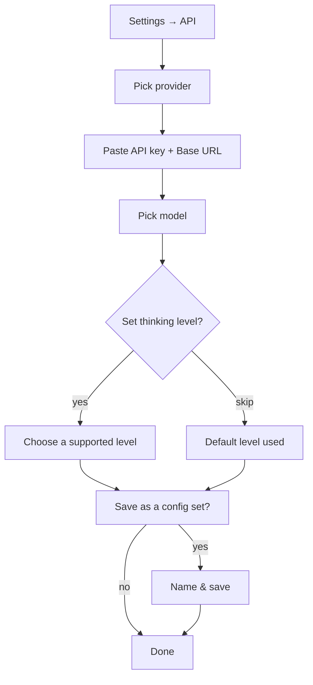

<!-- sources: src/main/config/config-store.ts (AppConfig), src/renderer/components/settings/SettingsAPI.tsx, src/renderer/components/ApiConfigSetManager.tsx, src/renderer/components/ProviderPicker.tsx, README, CHANGELOG 1.0.4–1.0.5 -->

# Models & API

## What it is / when to use it

Sqowe Pilot doesn't lock you to one AI vendor. You choose a **provider** (Anthropic,
OpenRouter, OpenAI-compatible, Gemini, GLM, MiniMax, Kimi, and others), paste an **API key**,
and pick a **model**. The provider/model list is backed by a live registry, so new models
appear without an app update. You can save several complete setups as **config sets** and
switch between them, and set the **reasoning effort** each model is allowed to use.

Reach for this page when: you're setting up the app for the first time, you want to try a
different model, you need a separate setup for work vs. personal, or you're routing traffic
through a corporate proxy.

## How to use it

1. Open **Settings** (⚙️ bottom-left) → **API** tab.
2. **Provider** — start typing in the searchable picker to filter the provider list.
3. **API Key** — paste your key. **Base URL** — set it if your provider requires one (e.g.
   Zhipu, MiniMax, Kimi); leave it blank for Anthropic direct.
4. **Model** — pick from the searchable model list. The **Thinking level** dropdown next to
   it shows only the levels that model actually supports.
5. **Config sets** — give the current setup a name and save it; switch between saved sets
   from the dropdown (also available on the Welcome screen).

<!-- derived:diagram source=src/renderer/components/settings/SettingsAPI.tsx,src/renderer/components/ApiConfigSetManager.tsx -->

<!-- /derived -->

> ⚠️ TODO (human): capture this → docs/wiki/assets/models-and-api-settings.png

### Per-model thinking level

Each model exposes a different set of reasoning levels (for example, some hide the highest
"extended thinking" tiers; some collapse several levels into one). The dropdown shows only
valid choices for the selected model, so you never pick something the model can't do. Your
choice is remembered per preference even when you switch models — it's simply clamped to the
nearest level the current model supports.

### HTTP proxy

If your network requires a proxy, set it under **Settings → General → HTTP Proxy** (format
`http://host:port`). All outbound model API requests are then routed through it. Leave it
blank to inherit your system/shell proxy settings. Proxy URLs may not include credentials.

## Commands & settings

| Setting             | Default              | What it does                                                                                                                            |
| ------------------- | -------------------- | --------------------------------------------------------------------------------------------------------------------------------------- |
| `provider`          | —                    | The active API provider.                                                                                                                |
| `apiKey`            | —                    | API key for the active provider.                                                                                                        |
| `baseUrl`           | _(provider default)_ | Custom API endpoint (required for Zhipu/MiniMax/Kimi/OpenRouter).                                                                       |
| `model`             | —                    | The active model name.                                                                                                                  |
| `thinkingLevel`     | `off` or `medium`    | Reasoning effort; clamped to what the model supports. (Older `enableThinking` on/off migrated to this: `true → medium`, `false → off`.) |
| `activeConfigSetId` | `default`            | Which saved config set is active.                                                                                                       |
| `configSets`        | one ("default")      | Your saved provider+model+key setups (up to 20).                                                                                        |
| `contextWindow`     | _(model default)_    | Override the model's context window size.                                                                                               |
| `maxTokens`         | _(model default)_    | Override the max output tokens.                                                                                                         |
| `claudeCodePath`    | _(auto)_             | Override the Claude Code CLI path.                                                                                                      |
| `localDevPath`      | _(empty)_            | Extra `PATH` directories for child processes (colon-separated).                                                                         |
| `httpProxy`         | _(empty)_            | Outbound API proxy URL.                                                                                                                 |

**Related guides:** [Chat & sessions](chat-and-sessions.md) uses the active model;
[Scheduling](scheduling.md) and [Remote control](remote-control.md) let you pick a config
set per task.

---

[← All docs](../index.md)
