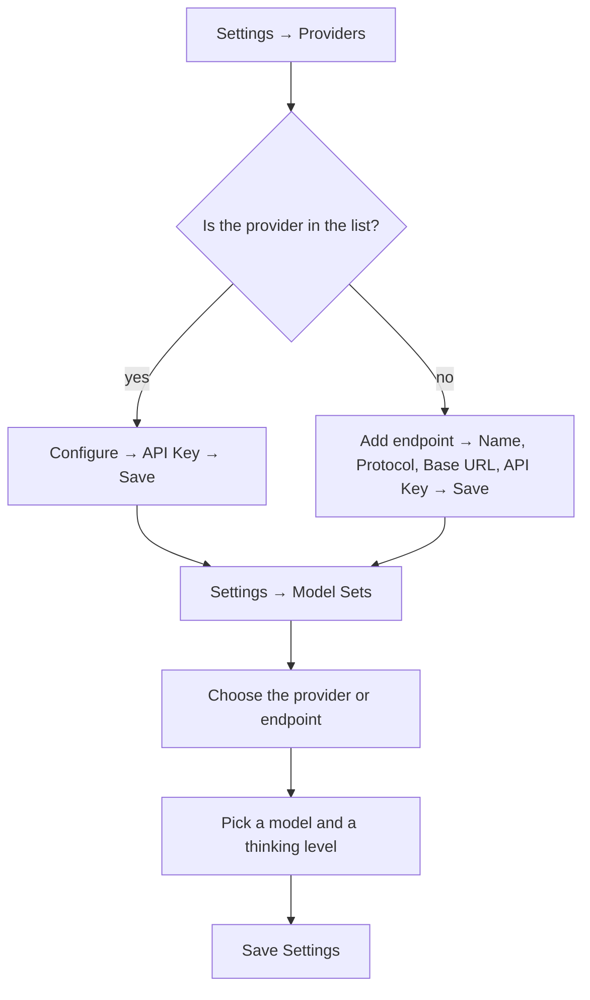

<!-- sources: src/main/config/config-store.ts (AppConfig, ProviderCredentials, CustomEndpoint, ApiConfigSet), src/renderer/components/settings/SettingsProviders.tsx, src/renderer/components/settings/SettingsModelSets.tsx, src/renderer/components/settings/ModelFieldsSection.tsx, src/renderer/components/ProviderConfigDialog.tsx, src/renderer/components/CustomEndpointDialog.tsx, src/renderer/components/ApiConfigSetManager.tsx, src/renderer/components/FirstRunWizard.tsx, src/renderer/i18n/locales/en.json, docs/design/archive/provider-credentials-and-model-sets.md, CHANGELOG 1.0.4–1.0.9 -->

# Models & API

## What it is / when to use it

Sqowe Pilot doesn't lock you to one AI vendor. Two things decide which model a chat runs on,
and each has its own tab in Settings:

- **Providers** — _where the keys are._ You enter the **API key** of each provider you use
  once (Anthropic, OpenRouter, OpenAI, Gemini, and the coding plans and inference services
  the app lists), and you can add **custom endpoints** of your own — a gateway, or any
  compatible service — each under a name you choose.
- **Model Sets** — _which provider and model to use._ A **config set** names a provider (or
  one of your custom endpoints), a **model**, and the **reasoning effort** that model may
  use. You can keep several config sets and switch between them.

A key belongs to its provider, not to a config set: enter or change it once, and every
config set on that provider uses it.

Reach for this page when: you're setting up the app for the first time, you want to try a
different model, you need separate setups (work vs. personal, a cloud provider vs. a gateway
on your own computer), or you're routing traffic through a corporate proxy.

## How to use it

### The first time

On a fresh install the Welcome screen says the API is not configured yet and offers **Go to
Settings**, which opens the **Providers** tab (see below).

If you send a message before anything is set up, a notice appears instead, with an **Open API
Settings** button. It opens a setup dialog with two steps:

1. **Step 1 of 2 · Provider** — choose a provider from the list, or **Add endpoint** for a
   service of your own; paste its **API Key**; press **Continue**. Under **Connection
   check** you can press **Diagnose Connection** first, to try the key before it is saved.
2. **Step 2 of 2 · Model** — pick the model and press **Get Started**.

Each step is saved on its own: if you close the dialog after the first step, the key is kept.

The setup dialog is for when nothing is set up at all. If the config set in use has no key but
another one is ready, the same button opens **Settings → Model Sets** instead, where you can
switch to it.

### Enter a provider's key

1. Open **Settings** (⚙️ bottom-left) → **Providers**.
2. Find the provider. The list is grouped: **Popular**, **Coding plans**, **Fast inference**
   and **Local**. Press **Configure** on its row.
3. Paste the **API Key**. Some providers also have a **Base URL** field — leave it empty to
   use the provider's usual address. For Ollama, **Find Local Ollama** looks for a server on
   this computer and fills in its address.
4. (Optional) Under **Connection check**, press **Diagnose Connection**. It runs against what
   you typed, saved or not.
5. Press **Save**.

Each row shows the state of its key — **Configured**, **Key missing** (a config set relies on
this provider and it has no key) or **Not set** — and which config sets use it.

> ⚠️ TODO (human): capture this → docs/wiki/assets/models-and-api-providers.png

### Add a custom endpoint

A custom endpoint is a gateway or compatible service the app does not list by name. You can
keep up to 20.

1. In **Settings → Providers**, under **Custom endpoints**, press **Add endpoint**.
2. (Optional) Open **Common provider setups** and press **Apply** on the service you use. It
   fills in the protocol, the address and an example model.
3. Enter a **Name** (left empty, the endpoint is named after its address), choose the
   **Protocol** — Anthropic, OpenAI or Gemini — and enter the **Base URL** and the **API
   Key**. A gateway on this computer may not need a key.
4. (Optional) Enter a **Default model**. It is filled in when a config set is first pointed
   at this endpoint.
5. Press **Save**.

If the address belongs to a provider the app lists itself, the dialog says so and offers to
open that provider's own entry instead. An endpoint that a config set runs on cannot be
deleted — point those config sets at another provider first.

### Choose the provider and model of a config set

1. Open **Settings** → **Model Sets**.
2. **API Provider** — choose what this config set runs on. Your custom endpoints come first,
   by name, then the providers. A dot beside the choice shows whether its key is in place;
   **Manage providers** takes you to the Providers tab to add one.
3. **Model** — pick from the searchable list, or press **Custom** to type a model ID
   yourself (**Use Preset** brings the list back). With Ollama the list is the models your
   server reports, and **Refresh Models** reads it again.
4. **Thinking Level** — choose how much reasoning effort the model may spend. Only the levels
   this model supports are shown.
5. Press **Save Settings**. It updates only the config set that is selected.

**Diagnose Connection**, at the bottom of the tab, runs the connection check for the selected
config set.

<!-- derived:diagram source=src/renderer/components/settings/SettingsProviders.tsx,src/renderer/components/settings/SettingsModelSets.tsx,src/renderer/components/ProviderConfigDialog.tsx,src/renderer/components/CustomEndpointDialog.tsx -->

<!-- /derived -->

> ⚠️ TODO (human): capture this → docs/wiki/assets/models-and-api-settings.png

### Keep several config sets

At the top of **Model Sets**, the **Config Set** list switches between your config sets.
**New Set** adds one, **Rename** renames the selected one, and the bin icon deletes it. You
can keep up to 20, and the default one cannot be deleted. If the selected set has unsaved
changes when you switch, the app asks whether to save or discard them first.

You can also switch config sets from the chat header and from the Welcome screen, where each
one is listed as "name · model".

### Per-model thinking level

Each model exposes a different set of reasoning levels (for example, some hide the highest
"extended thinking" tiers; some collapse several levels into one). The control shows only
valid choices for the selected model, so you never pick something the model can't do. Your
choice is remembered per preference even when you switch models — it's simply clamped to the
nearest level the current model supports.

### HTTP proxy

If your network requires a proxy, set it under **Settings → General → HTTP Proxy** (format
`http://host:port`). All outbound model API requests are then routed through it. Leave it
blank to inherit your system/shell proxy settings. Proxy URLs may not include credentials.

## Commands & settings

| Setting               | Default           | What it does                                                                                                                            |
| --------------------- | ----------------- | --------------------------------------------------------------------------------------------------------------------------------------- |
| `providerCredentials` | _(empty)_         | The API key of each provider — and its address, where the provider has one — saved once per provider.                                   |
| `customEndpoints`     | _(none)_          | Your custom endpoints (up to 20): name, protocol, Base URL, API key and an optional default model.                                      |
| `configSets`          | one ("Default")   | Your config sets (up to 20). Each holds a provider or custom endpoint, a model, a thinking level and optional limits — never a key.     |
| `activeConfigSetId`   | `default`         | Which config set is in use.                                                                                                             |
| `provider`            | —                 | The provider the active config set runs on.                                                                                             |
| `model`               | —                 | The model of the active config set.                                                                                                     |
| `thinkingLevel`       | `off` or `medium` | Reasoning effort; clamped to what the model supports. (Older `enableThinking` on/off migrated to this: `true → medium`, `false → off`.) |
| `contextWindow`       | _(model default)_ | Override the model's context window size, per config set.                                                                               |
| `maxTokens`           | _(model default)_ | Override the max output tokens, per config set.                                                                                         |
| `httpProxy`           | _(empty)_         | Outbound API proxy URL.                                                                                                                 |

**Related guides:** [Chat & sessions](chat-and-sessions.md) uses the active config set;
[Getting started](../getting-started.md) walks through the first setup.

---

[← All docs](../index.md)
