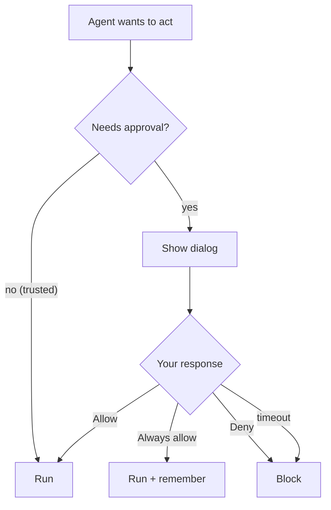

<!-- sources: src/renderer/components/PermissionDialog.tsx, src/renderer/components/settings/SettingsGeneral.tsx, src/main/tools/, src/main/sandbox/, src/main/config/config-store.ts (AppConfig), ARCHITECTURE.md §4.4, §7 -->

# Approvals & safety

## What it is / when to use it

The agent is powerful, so sensitive actions don't happen silently. Before the agent runs a
shell command, writes or edits a file, or takes a potentially destructive step, an
**approval dialog** appears describing exactly what it wants to do. You decide each time, and
you can shape which actions need asking at all. On top of that, all file work is confined to
your [workspace](workspaces.md), and optional VM isolation adds another layer.

This is always on — reach for the settings here when you want to reduce prompts, get
notified, or harden isolation.

## Approving actions

When the agent wants to act, you see **what tool**, its **input**, and a warning for
system-modifying actions. Choose:

- **Allow** — run it this once.
- **Always allow this tool** — stop being asked for this specific tool.
- **Deny** — block it.

If you don't respond within the **permission timeout**, the action is auto-denied (so nothing
dangerous slips through while you're away).

### Progressive trust

When you manually approve the same MCP tool several times, the app suggests promoting it to
permanent auto-allow — see [MCP connectors](mcp-connectors.md).

### Desktop notifications

Turn on **Settings → General → Desktop notifications** to get a native OS notification when
the app isn't focused and a permission request arrives, or a task finishes.

<!-- derived:diagram source=src/main/tools/,src/main/claude/before-tool-call-hook.ts -->

<!-- /derived -->

## Isolation layers

| Layer                | Platform | What it does                                                                    | Status               |
| -------------------- | -------- | ------------------------------------------------------------------------------- | -------------------- |
| **Path containment** | All      | All file operations are confined to your workspace folder; escapes are blocked. | ✅ Active by default |
| **WSL2 VM**          | Windows  | Commands execute inside an isolated Linux VM; the workspace is synced in.       | ⚠️ Experimental      |
| **Lima VM**          | macOS    | Commands execute inside an Ubuntu VM with `/Users` mounted.                     | ⚠️ Experimental      |

> ⚠️ **VM sandbox is experimental.** The backend is code-complete, but it is **off by
> default** and the UI is still stabilizing. Path containment (the basic layer) is always on.
> If you turn VM isolation on, first-run setup downloads/creates the VM and may take a few
> minutes; you can always fall back to **Native mode**. See `ARCHITECTURE.md` §4.4 for the
> current status before relying on it.

> ⚠️ TODO (human): capture this → docs/wiki/assets/permissions-dialog.png

## Commands & settings

| Action                   | How to run                                                  |
| ------------------------ | ----------------------------------------------------------- |
| Approve / deny an action | Permission dialog → **Allow** / **Always allow** / **Deny** |
| Toggle notifications     | Settings → General → **Desktop notifications**              |
| Set approval timeout     | Settings → Bash Commands → **Permission timeout**           |
| Turn on VM sandbox       | Settings → Sandbox → **Enable Sandbox Mode** (experimental) |

| Setting                    | Default | What it does                                                 |
| -------------------------- | ------- | ------------------------------------------------------------ |
| `notificationsEnabled`     | on      | Native notifications when unfocused (approvals, completion). |
| `permissionTimeoutSeconds` | `300`   | Seconds before an approval auto-denies.                      |
| `sandboxEnabled`           | off     | VM-level command isolation (experimental).                   |

**Related guides:** [Bash restrictions](bash-restrictions.md) decides which commands skip the
dialog; [Workspaces](workspaces.md) defines the path-containment boundary.

---

[← All docs](../index.md)
