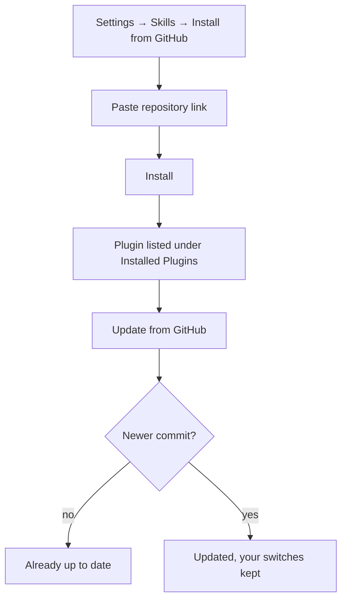

<!-- sources: src/renderer/components/settings/SettingsSkills.tsx, src/renderer/components/settings/PluginGitHubInstallDialog.tsx, src/main/skills/plugin-runtime-service.ts, src/main/skills/plugin-github-source.ts, src/shared/plugin-github-url.ts, src/main/skills/plugin-registry-store.ts, src/main/skills/plugin-catalog-service.ts, src/renderer/components/ContextPanel.tsx, docs/design/archive/plugin-archive-install-and-pin.md, docs/design/plugin-github-install.md -->

# Plugins

## What it is / when to use it

A **plugin** is a bundle — one or more skills, commands, agents, hooks, and MCP configs —
packaged as a unit. Installing a plugin brings in everything it contains; you can then enable
or disable individual components. Plugins come from the **Claude marketplace**, from a local
`.plugin` / `.zip` archive, or straight from a **GitHub** repository.

Reach for this when: you want to add a coherent set of capabilities at once (rather than
one skill at a time), you've downloaded a plugin archive, or a plugin's README points you to
its GitHub repository.

## How to use it

1. Open **Settings → Skills → Plugins & Imports**.
2. Pick where the plugin comes from:
   - **Browse Plugins** to search the marketplace,
   - **Import Plugin** to load a local `.plugin`/`.zip` archive,
   - **Install from GitHub** to paste a repository link.
3. Click **Install**. At install time, the plugin is scanned for an **orchestrator** entry
   point (a skill that coordinates/delegates); if found, it's advertised to the agent.
4. Under **Installed Plugins**, use the power button to enable or disable a plugin, and the
   component buttons below it (skills, commands, agents, hooks, mcp) to switch single
   components on or off. For safety, **hooks** and **MCP** components are disabled by default
   and must be turned on explicitly after install.
5. The **Uninstall** button (trash icon) removes the plugin and its runtime files.

A plugin is a set of instructions the AI will follow. Install only from sources you trust.

### Install from GitHub

Paste any of these into the **Repository link** field:

- `https://github.com/owner/repo` (with or without `.git`)
- a link to one plugin's folder: `https://github.com/owner/repo/tree/main/plugins/name`
- a link to a branch or tag: `https://github.com/owner/repo/tree/v2.0.0`
- the short form `owner/repo`

The repository can be a plugin itself, or a plugin marketplace that lists one plugin kept in
the same repository. When a marketplace lists several plugins, you're told their names —
link the folder of the one you want instead. Only public repositories are supported.

Symbolic links inside a plugin are never installed. If a plugin had any, the success message
names them. Example: the `CLAUDE.md` in `coreyhaines31/marketingskills` is one, and the plugin
works without it.

### Update a plugin from GitHub

A plugin installed from GitHub shows its repository, branch or tag, and commit under its
name, plus an **Update from GitHub** button. Update checks for a newer commit first:

- No new commit: you see "already up to date", and nothing is downloaded.
- New commit: the plugin is replaced with it. The plugin's on/off switch and its component
  switches stay as you set them. Any component that appears for the first time starts with
  the install defaults, so new hooks and MCP stay off.

If the plugin was renamed in its repository, Update stops and asks you to uninstall it and
install it again.

<!-- derived:diagram source=src/renderer/components/settings/SettingsSkills.tsx, src/renderer/components/settings/PluginGitHubInstallDialog.tsx -->

<!-- /derived -->

### Pin a plugin for a session

Pinning an entire plugin injects a compact directive into the prompt (~60–80 tokens) telling
the agent to prioritize it — far cheaper than pinning each of its skills individually (~1480
tokens), and it bypasses the 10-skill pinning cap. In the **Context Panel → Plugins**, click
**Pin plugin** / **Unpin plugin**.

> ⚠️ TODO (human): capture this → docs/wiki/assets/plugins-settings.png

> ⚠️ TODO (human): capture this → docs/wiki/assets/plugins-install-from-github.png

## Commands & settings

| Action                | How to run                                                       |
| --------------------- | ---------------------------------------------------------------- |
| Browse marketplace    | Settings → Skills → **Browse Plugins**                           |
| Import archive        | Settings → Skills → **Import Plugin** (`.plugin` / `.zip`)       |
| Install from GitHub   | Settings → Skills → **Install from GitHub** → paste the link     |
| Update from GitHub    | Installed Plugins → **Update from GitHub** (GitHub plugins only) |
| Enable / disable      | Installed Plugins → power button, or a component button          |
| Pin plugin to session | Context Panel → Plugins → **Pin plugin**                         |
| Uninstall             | Installed Plugins → **Uninstall** (trash icon)                   |

**Related guides:** [Skills](skills.md), [Pin skills & profiles](skill-pinning-and-profiles.md).
Archive and GitHub installs are protected against path traversal and oversized downloads.

---

[← All docs](../index.md)
