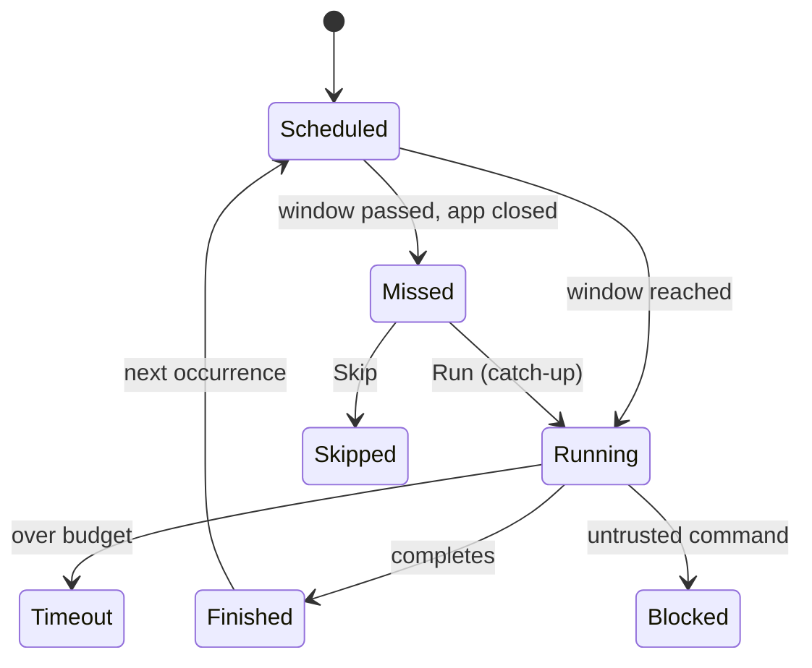

<!-- sources: src/renderer/components/settings/SettingsSchedule.tsx, src/renderer/components/ScheduleCatchUpPanel.tsx, src/main/schedule/scheduled-task-manager.ts, src/main/config/config-store.ts (scheduler settings), docs/design/archive/scheduler-v2.md -->

# Scheduling

## What it is / when to use it

The scheduler runs prompts **automatically** on a schedule — daily at certain times, on
certain weekdays, or once. It's anacron-style: tasks target a fuzzy **time window** (e.g.
"Morning 09:00–11:00") and fire at a random moment inside it, so a laptop that was asleep
catches up gracefully. Each run can have a time/token **budget**, and missed tasks can be
caught up when the app reopens.

Reach for this when: you want a recurring report, a nightly cleanup, or any task that should
run without you typing it.

## How to use it

1. Open **Settings → Schedules** → **Create task**.
2. Write the **prompt** to run (and optionally pick a **project directory** and a
   **config set** — which model/credentials to use).
3. Choose **Run timing**:
   - **Daily** — pick one or more time slots (any `HH:mm`).
   - **Weekly** — pick weekdays + time slots.
   - **One-time** — a single future time.
   - Optionally wrap the time in a **Time window** (Morning / Afternoon / Evening / Night /
     Exact).
4. Choose **Execution mode**: **Ask before running** or **Run automatically** (auto mode runs
   silently; commands not on your trust list are blocked).
5. Optionally set **Budget limits** — max duration (minutes) and/or max tokens.
6. **Create task**.

From the schedule list you can **Run now**, **Stop run**, **Edit**, **Enable/Disable**, or
**Delete** a task, and see its **next run**, **last run**, and **run history** (success /
failed / timeout / blocked / skipped, with duration, tokens, and any blocked commands).

### Catch-up

If tasks missed their window while the app was closed, a **Missed Scheduled Tasks** panel
lets you **Run** / **Skip** each one (or **Run All** / **Skip All**), controlled by your
catch-up policy.

<!-- derived:diagram source=src/main/schedule/scheduled-task-manager.ts -->

<!-- /derived -->

> ⚠️ TODO (human): capture this → docs/wiki/assets/scheduling-settings.png

## Commands & settings

| Action                         | How to run                             |
| ------------------------------ | -------------------------------------- |
| Create task                    | Settings → Schedules → **Create task** |
| Run now / Stop / Edit / Delete | Schedule list row actions              |
| View run history               | Schedule → **Run history**             |
| Catch up missed tasks          | Missed-tasks panel → **Run / Skip**    |

| Setting                    | Default | What it does                                                                          |
| -------------------------- | ------- | ------------------------------------------------------------------------------------- |
| `schedulerCatchUpPolicy`   | `ask`   | What happens when a task misses its window (`skip` / `run-once` / `run-all` / `ask`). |
| `schedulerConflictPolicy`  | `queue` | What happens when the agent is already busy (`queue` / `skip-if-busy`).               |
| `schedulerRunHistoryDepth` | `10`    | Past runs kept per task.                                                              |

**Related guides:** tasks use a [config set](models-and-api.md) and respect your
[bash restrictions](bash-restrictions.md) (untrusted commands are blocked in auto mode).

---

[← All docs](../index.md)
