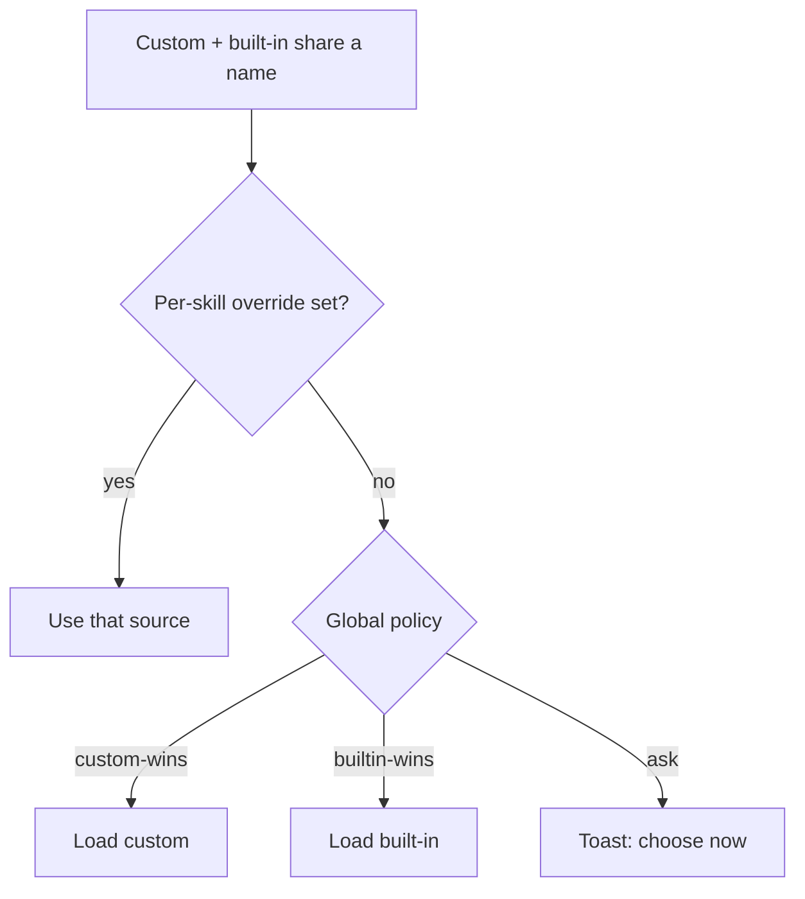

<!-- sources: src/renderer/components/settings/SettingsSkills.tsx, src/main/skills/skill-conflict-detector.ts, src/shared/skill-conflict-types.ts, docs/design/archive/skill-conflict-resolution.md -->

# Resolve skill conflicts

## What it is / when to use it

A **conflict** happens when a custom skill and a built-in skill share the same name — the
agent can only load one. The conflict policy decides which version wins, so behavior stays
predictable instead of depending on load order.

Reach for this when: you've added a custom skill that collides with a built-in, or you see a
conflict badge or toast and want to decide what loads.

## How to use it

1. Open **Settings → Skills → Conflict Resolution**.
2. Pick a global policy:
   - **Custom wins (recommended)** — your skills always take priority.
   - **Built-in wins** — app-maintained skills take priority; colliding custom skills are
     ignored.
   - **Ask me each time** — show a notification whenever a conflict is detected.
3. For an individual skill, set a **per-skill source override** (Built-in / User / Project /
   Configured) to decide exactly which copy loads, regardless of the global policy.

A **conflict count badge** appears on the Settings sidebar when conflicts exist. When
**Ask me each time** is on, a toast lets you choose **Use Custom** / **Use Built-in** /
**Open Settings** / **Dismiss** the moment a conflict is detected.

<!-- derived:diagram source=src/main/skills/skill-conflict-detector.ts -->

<!-- /derived -->

## Commands & settings

| Action             | How to run                                     |
| ------------------ | ---------------------------------------------- |
| Set global policy  | Settings → Skills → Conflict Resolution        |
| Per-skill override | Skill entry → **Active source**                |
| Resolve on the fly | Conflict toast → **Use Custom / Use Built-in** |

| Setting                              | Default       | What it does                      |
| ------------------------------------ | ------------- | --------------------------------- |
| `skillConflictConfig.policy`         | `custom-wins` | How name collisions are resolved. |
| `skillConflictConfig.overrides`      | _(empty)_     | Per-skill source choices.         |
| `skillConflictConfig.disabledSkills` | _(empty)_     | Globally disabled skill IDs.      |

**Related guides:** [Skills](skills.md), [Pin skills & profiles](skill-pinning-and-profiles.md).

---

[← All docs](../index.md)
