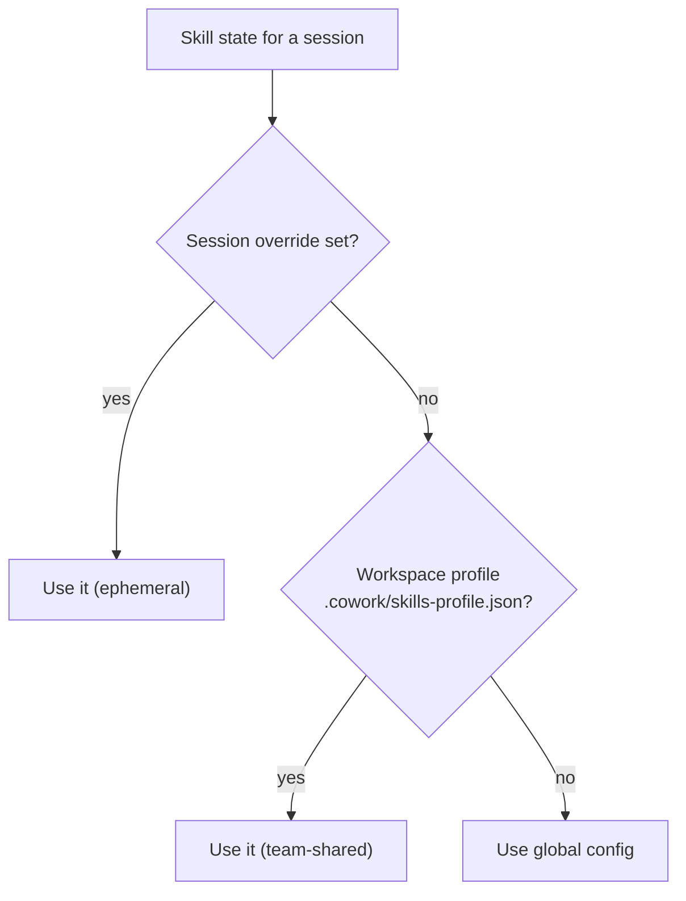

<!-- sources: src/renderer/components/ContextPanel.tsx, src/renderer/components/WelcomeView.tsx, src/main/skills/skills-workspace-profile.ts, src/shared/skill-pinning-constants.ts, docs/design/archive/skill-pinning-ux.md, docs/design/archive/skill-workspace-profiles.md -->

# Pin skills & workspace profiles

## What it is / when to use it

Skills are always available to the agent, but it doesn't always _use_ them unless told.
**Pinning** a skill injects an explicit "prioritize this" directive into the prompt for the
current session. **Workspace profiles** let you go further: disable skills you don't need for
a given project, shrinking the prompt and reclaiming context-window tokens. Both can be saved
per-project and shared with your team via git.

Reach for this when: the agent keeps ignoring a skill you want it to use, or a project has a
big skill list and you want to trim it.

## How to use it

There are three skill states in a session: **★ Pinned** (prioritized), **☆ Available**
(normal), and **✕ Removed** (disabled).

- **Before a chat** — on the Welcome screen, open the skills picker, pin the ones you want
  prioritized, and remove any you don't need for this chat.
- **Mid-conversation** — open the **Context Panel → Pinned Skills**. Pin or unpin with the
  ★ button; remove a skill with **Remove from session**; restore it from the **Removed**
  section.

Pinning is capped at **10 skills per session** to keep the prompt lean.

### Save a workspace profile

When you've got a session's skills just right and a working folder is set, click
**Save to workspace** (💾). This writes `.cowork/skills-profile.json` so the same pinned/
disabled setup loads automatically the next time anyone opens that project.

<!-- derived:diagram source=src/main/skills/skills-workspace-profile.ts,src/main/session/session-manager.ts -->

<!-- /derived -->

> ⚠️ TODO (human): capture this → docs/wiki/assets/skill-pinning-context-panel.png

## Commands & settings

| Action                    | How to run                                            |
| ------------------------- | ----------------------------------------------------- |
| Pin / unpin a skill       | Welcome screen picker, or Context Panel → ★           |
| Remove / restore a skill  | Context Panel → **Remove from session** / **Restore** |
| Save profile to workspace | **Save to workspace** (💾) in Context Panel / Welcome |

Profile resolution follows three layers, highest priority wins: **Session** (ephemeral) →
**Workspace profile** (`.cowork/skills-profile.json`) → **Global config**.

**Related guides:** [Skills](skills.md), [Resolve conflicts](skill-conflicts.md). The same
three-layer pattern applies to [MCP connectors](mcp-connectors.md).

---

[← All docs](../index.md)
