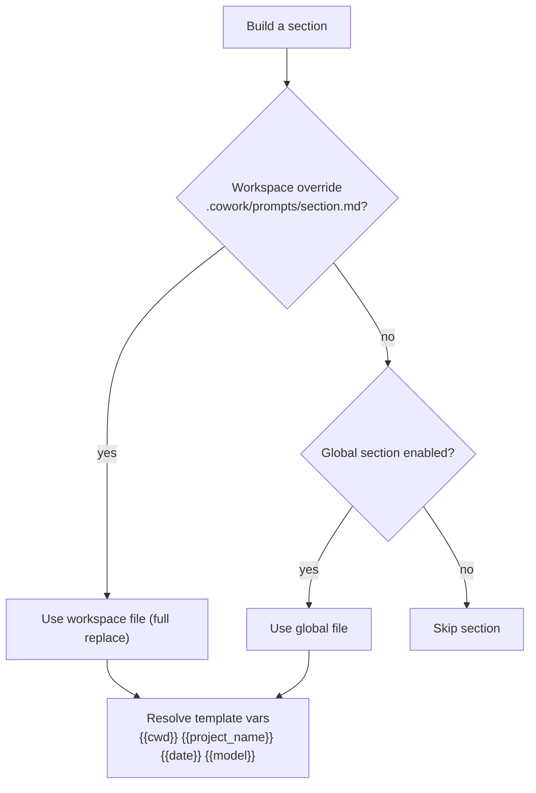

<!-- sources: src/renderer/components/settings/SettingsPrompt.tsx, src/main/prompts/prompt-loader.ts, src/main/config/config-store.ts (AppConfig), ARCHITECTURE.md §4.5 -->

# System prompt customization

## What it is / when to use it

The agent's behavior is shaped by a **system prompt** assembled from editable section files.
You can rewrite the agent's identity, its behavioral rules, how it cites things, and how it
routes tasks to tools — without touching code. You can also override any section **per
workspace**, so a project can have its own agent personality.

Reach for this when: you want the agent to follow a specific style, tone, or process, or a
particular project needs different rules.

## How to use it

1. Open **Settings → System Prompt**.
2. Edit any section — **identity**, **behavioral-rules**, **citations**, **tool-routing**.
   Each section can be independently **edited**, **disabled**, or **reset to default**.
3. Use **template variables** that are resolved at runtime: `{{cwd}}`, `{{project_name}}`,
   `{{date}}`, `{{model}}`.
4. Sections are stored as files in your user data directory under `prompts/`.

### Workspace overrides

For a per-project identity/rules, create a file at `{workspace}/.cowork/prompts/{section}.md`
(e.g. `.cowork/prompts/identity.md`). If it exists, it **completely replaces** the global
section for that workspace only — a full-replace model, not a merge.

<!-- derived:diagram source=src/main/prompts/prompt-loader.ts -->

<!-- /derived -->

> ⚠️ TODO (human): capture this → docs/wiki/assets/system-prompt-settings.png

## Commands & settings

| Action                    | How to run                                        |
| ------------------------- | ------------------------------------------------- |
| Edit a section            | Settings → System Prompt → edit                   |
| Disable / reset a section | Section menu → **Disable** / **Reset to default** |
| Override per workspace    | Create `{workspace}/.cowork/prompts/{section}.md` |

For a lighter per-project touch (a single instructions file, no full prompt edits), see the
[workspace instructions file](workspaces.md).

---

[← All docs](../index.md)
