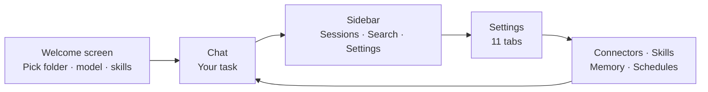

# Sqowe Pilot

Sqowe Pilot is a free, open-source desktop AI agent for **Windows** and **macOS**. You point
it at a folder, give it a task in plain language, and it does the work — reading and writing
files, generating documents, controlling other apps, searching the web, and remembering what
you did last time. It runs locally on your computer; your files stay in your workspace, and
the only thing that leaves your machine is the conversation you send to the AI model you
choose.

It supports many models (Claude, OpenAI-compatible, Gemini, GLM, MiniMax, Kimi, and more),
connects to external tools through **MCP**, ships ready-made **Skills** for documents and
data, can be driven remotely from **Feishu** or **Slack**, and can operate desktop apps by
**looking at the screen**.

> ⚠️ TODO (human): one-sentence brand pitch / who Sqowe Pilot is for (the "why" in your voice).

## What you can do

- **[Chat with an AI agent](features/chat-and-sessions.md)** — have it do real work in a folder you choose, with live reasoning and tool traces.
- **[Pick a model](features/models-and-api.md)** — choose from many providers, save several setups as "config sets", and set the reasoning effort per model.
- **[Work in a workspace](features/workspaces.md)** — select a folder, manage files safely inside it, and override instructions per project.
- **[Generate documents with Skills](features/skills.md)** — built-in workflows for PowerPoint, Word, PDF, and Excel, plus your own custom skills.
- **[Pin skills & manage profiles](features/skill-pinning-and-profiles.md)** — tell the agent which skills to prioritize, and trim unused ones to save context.
- **[Resolve skill conflicts](features/skill-conflicts.md)** — decide what happens when a custom skill and a built-in share a name.
- **[Install plugins](features/plugins.md)** — add bundles of skills, commands, and agents from the marketplace or a local archive.
- **[Connect external tools (MCP)](features/mcp-connectors.md)** — plug in browsers, Notion, databases, and your own services.
- **[Remember across sessions](features/memory.md)** — the agent learns your preferences and recalls past conversations, with local embeddings by default.
- **[Schedule tasks](features/scheduling.md)** — run prompts automatically on a daily/weekly schedule with budgets and catch-up.
- **[Control remotely](features/remote-control.md)** — drive the agent from Feishu (Lark) or Slack.
- **[Operate the GUI](features/gui-operation.md)** — let the agent see your screen and click through desktop apps.
- **[Customize the system prompt](features/system-prompt.md)** — edit the agent's identity, rules, and tool routing, per project.
- **[Gate shell commands](features/bash-restrictions.md)** — trust safe commands, always block dangerous ones.
- **[Search conversations](features/search.md)** — jump to any past chat with `Ctrl`/`Cmd`+`K`.
- **[Approvals & safety](features/permissions-and-safety.md)** — review every sensitive action before it runs.

<!-- derived:diagram source=src/renderer/components/Sidebar.tsx,src/renderer/components/SettingsPanel.tsx,src/renderer/components/WelcomeView.tsx -->

<!-- /derived -->

## Get started

New here? [Get started](getting-started.md) walks through install, adding an API key, and
running your first task.

Looking for a specific button or setting? Jump to the reference:
[Commands](reference/commands.md) · [Settings](reference/settings.md).
